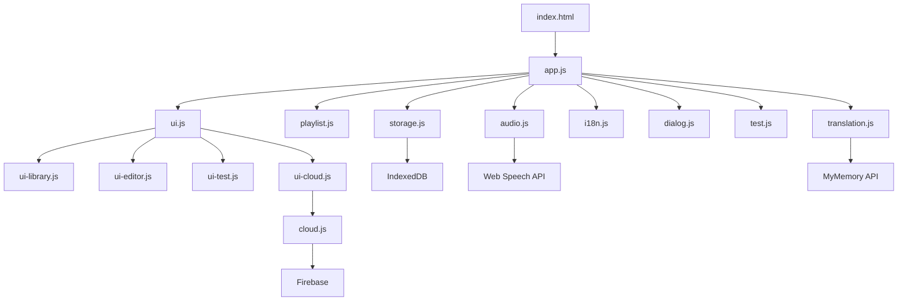
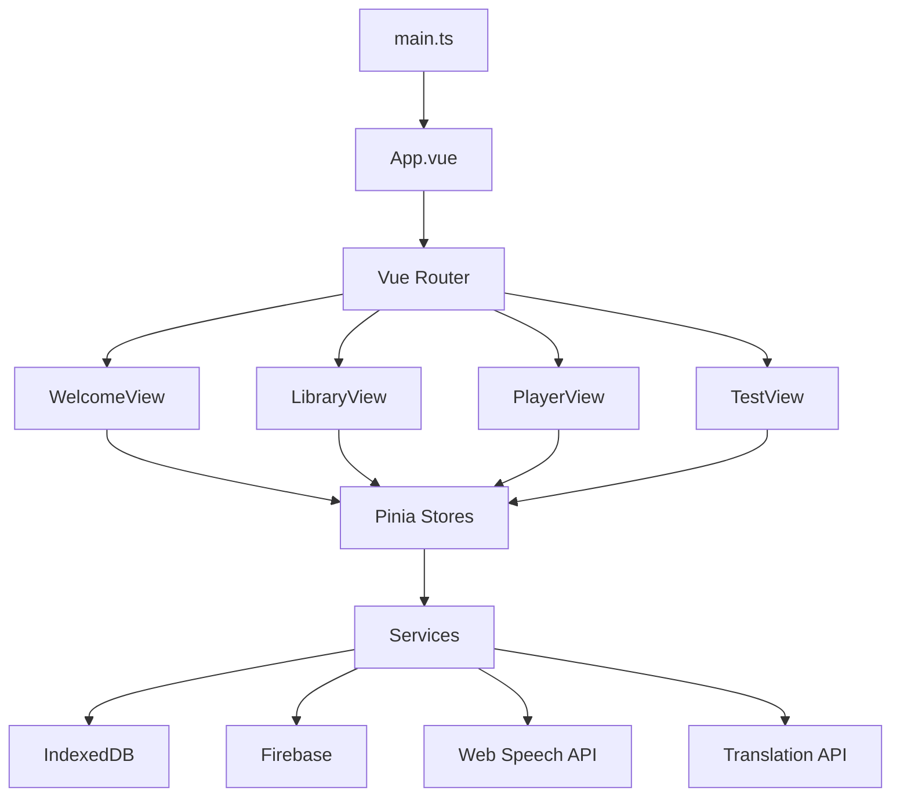

# Language Loop — Migration Plan: Vue 3 + TypeScript + Tailwind CSS

> **Implementation note (Phase 0):** The new Vue app lives in the **`app/`** subdirectory (its own `package.json`, `vite.config.ts`, `index.html`, and `src/`). This keeps the legacy app fully working at the repository root during the parallel build. Run it with `npm run app:dev` from the root, or `npm run dev` inside `app/`. The folder structure below shows the contents of `app/`.

## 1. Executive Summary

Migrate the current vanilla-JS PWA (Language Loop) to a modern **Vue 3 + Vite + TypeScript** stack, with **Tailwind CSS + DaisyUI** for styling, **Pinia** for state, **Vue Router** for navigation, **vue-i18n** for localization, and **vite-plugin-pwa** for offline support.

The migration follows a **strangler-fig / phased rewrite** strategy: build the new app in `src/` alongside the existing app, reuse the pure logic and data layer, and cut over view-by-view once feature parity is reached. This keeps the app shippable throughout.

### Recommended stack

| Concern | Choice | Why |
|---|---|---|
| Framework | Vue 3 (`<script setup>`) | Composition API, small runtime, great DX |
| Build | Vite | Fast HMR, native TS, PWA plugin |
| Language | TypeScript | Typed models, safer refactors |
| Styling | Tailwind CSS + DaisyUI | Custom design preserved, themeable, tiny bundle |
| State | Pinia | Replaces global managers, typed stores |
| Routing | Vue Router | Replaces manual `showView()` |
| i18n | vue-i18n | Replaces custom `i18n.js` |
| PWA | vite-plugin-pwa | Replaces hand-written `sw.js` |
| DB | `idb` (or keep custom wrapper) | Promise-based IndexedDB |
| Cloud | Firebase v12 modular SDK | Already in use |
| Tests | Vitest + Vue Test Utils | Reuse existing logic tests |
| Lint/Format | ESLint + Prettier | Already configured |

### Why Tailwind + DaisyUI (not Vuetify/Element)

- The app has a **strong custom design system** with 6 themes. Tailwind preserves that identity; Material/Element would overwrite it.
- **DaisyUI themes** map directly onto the existing `data-theme` values (`dark`, `light`, `ocean`, `forest`, `sunset`, `midnight`).
- **Mobile-first** utilities match the PWA layout.
- **Tiny production bundle** after purging unused classes.
- If ready-made accessible components are preferred, **shadcn-vue** (Tailwind + Radix Vue) is the drop-in alternative.

---

## 2. Current Architecture Inventory

### 2.1 Modules and responsibilities

| File | Responsibility | Migration target |
|---|---|---|
| `js/constants.js` | App version, defaults, language/theme names | `src/constants.ts` |
| `js/events.js` | Global event bus | Pinia stores / `mitt` |
| `js/logic.js` | Pure helpers (normalize, diff, similarity, language map) | `src/lib/logic.ts` (keep tests) |
| `js/dialog.js` | Custom alert/confirm/prompt | `useDialog()` composable + `Dialog.vue` |
| `js/languages.js` | Language list + select helpers | `src/constants/languages.ts` |
| `js/storage.js` | IndexedDB CRUD (playlists, sentences, groups, settings) | `src/services/db.ts` + `storage.ts` |
| `js/i18n.js` | JSON loader + `data-i18n` DOM updater | `vue-i18n` |
| `js/translation.js` | MyMemory translation API + cache | `src/services/translation.ts` |
| `js/welcome.js` | First-run language setup | `WelcomeView.vue` + `useSettings` |
| `js/test.js` | Writing/speaking test logic | `src/stores/test.ts` |
| `js/audio.js` | TTS, playback, recording, sleep timer, wake lock | `src/services/audio.ts` + `useAudio()` |
| `js/playlist.js` | Playlist/group operations | `src/stores/playlists.ts` + `groups.ts` |
| `js/ui.js` | View switching, rendering, modals, toasts, theme | `App.vue`, `useUi`, `useTheme`, `useToast` |
| `js/ui-library.js` | Library actions, import/export, stats | `LibraryView.vue` + stores |
| `js/ui-editor.js` | Sentence editor, recording, voice input | `SentenceEditor.vue` |
| `js/ui-test.js` | Test view rendering | `TestView.vue` |
| `js/ui-cloud.js` | Cloud sync UI | `CloudSyncModal.vue` + `useCloud` |
| `js/cloud.js` | Firebase auth + Firestore | `src/services/cloud.ts` |
| `js/app.js` | Bootstrap, session restore, SW registration | `main.ts` + `App.vue` |
| `sw.js` | Service worker (cache) | `vite-plugin-pwa` |
| `index.html` | All views + modals | `App.vue` + router views |
| `css/styles.css` | Design system + themes | `src/styles/main.css` + Tailwind config |

### 2.2 Data models (from `storage.js` JSDoc)

```ts
interface PlaylistSettings {
  repeatCount: number;
  pauseDuration: number;
  speechRate: number;
  preferredVoice: string;
  speakNative: boolean;
}

interface Playlist {
  id?: number;
  cloudId: string;
  version: number;
  name: string;
  icon: string;
  description: string;
  targetLang: string;
  nativeLang: string;
  groupId: number | null;
  createdAt: number;
  lastPlayedAt: number | null;
  settings: PlaylistSettings;
}

interface Sentence {
  id?: number;
  playlistId: number;
  targetText: string;
  nativeText: string;
  memo: string;
  targetLang: string;
  nativeLang: string;
  customAudio: Blob | null;
  order: number;
  disabled?: boolean;
  successCount?: number;
}

interface Group {
  id?: number;
  name: string;
  icon: string;
  order: number;
  collapsed?: boolean;
  createdAt: number;
}
```

### 2.3 Current architecture diagram



---

## 3. Target Architecture

### 3.1 Folder structure

```
language-loop/
├── index.html
├── package.json
├── vite.config.ts
├── tsconfig.json
├── tailwind.config.ts
├── postcss.config.js
├── public/
│   ├── manifest.json
│   ├── assets/icons/
│   └── i18n/*.json
├── src/
│   ├── main.ts
│   ├── App.vue
│   ├── router/index.ts
│   ├── constants/
│   │   ├── index.ts
│   │   └── languages.ts
│   ├── types/
│   │   ├── models.ts
│   │   └── cloud.ts
│   ├── lib/
│   │   └── logic.ts
│   ├── services/
│   │   ├── db.ts
│   │   ├── storage.ts
│   │   ├── audio.ts
│   │   ├── translation.ts
│   │   └── cloud.ts
│   ├── stores/
│   │   ├── playlists.ts
│   │   ├── groups.ts
│   │   ├── player.ts
│   │   ├── settings.ts
│   │   ├── test.ts
│   │   ├── cloud.ts
│   │   └── ui.ts
│   ├── composables/
│   │   ├── useAudio.ts
│   │   ├── useSpeech.ts
│   │   ├── useTheme.ts
│   │   ├── useDialog.ts
│   │   ├── useToast.ts
│   │   └── useI18n.ts
│   ├── components/
│   │   ├── layout/AppHeader.vue
│   │   ├── ui/BaseButton.vue
│   │   ├── ui/BaseModal.vue
│   │   ├── ui/BaseInput.vue
│   │   ├── ui/BaseSelect.vue
│   │   ├── ui/ToastHost.vue
│   │   ├── ui/DialogHost.vue
│   │   ├── playlist/PlaylistCard.vue
│   │   ├── playlist/PlaylistGrid.vue
│   │   ├── playlist/GroupCard.vue
│   │   ├── player/PlayerControls.vue
│   │   ├── player/SentenceList.vue
│   │   ├── player/SentenceItem.vue
│   │   ├── editor/SentenceEditor.vue
│   │   ├── editor/PlaylistEditor.vue
│   │   ├── editor/IconPicker.vue
│   │   ├── test/TestPrompt.vue
│   │   ├── test/TestFeedback.vue
│   │   └── cloud/CloudSyncModal.vue
│   ├── views/
│   │   ├── WelcomeView.vue
│   │   ├── LibraryView.vue
│   │   ├── PlayerView.vue
│   │   └── TestView.vue
│   └── styles/
│       ├── main.css
│       └── themes.css
├── tests/
│   └── logic.test.ts
└── ...
```

### 3.2 Target architecture diagram



### 3.3 Service and store mapping

| Current | Target | Notes |
|---|---|---|
| `storage` singleton | `services/db.ts` + `services/storage.ts` | Keep IndexedDB schema; wrap in typed functions |
| `playlistManager` | `stores/playlists.ts` + `stores/groups.ts` | Actions become store actions |
| `audioEngine` | `services/audio.ts` + `composables/useAudio.ts` | Keep class, expose reactive state |
| `testManager` | `stores/test.ts` | Reactive test state |
| `i18n` | `vue-i18n` | Migrate JSON to `locales/` |
| `dialog` | `composables/useDialog.ts` + `DialogHost.vue` | Promise-based API preserved |
| `events` | Pinia + `mitt` (optional) | Prefer store subscriptions |
| `translationService` | `services/translation.ts` | Keep cache |
| `cloudService` | `services/cloud.ts` | Lazy-loaded, keep race-condition fix |
| `ui` | `App.vue` + `useUi` + `useTheme` + `useToast` | Router replaces view switching |

---

## 4. Migration Strategy

### 4.1 Approach: parallel build + phased cutover

1. Keep the existing app fully working on the current `index.html`.
2. Build the Vue app in `src/` with its own `index.html` entry (Vite).
3. Reuse pure logic (`logic.js` → `logic.ts`) and the IndexedDB schema so data is shared.
4. Migrate view-by-view; each view is feature-complete before moving on.
5. Cut over when parity is reached; remove legacy files.

### 4.2 Migration flow diagram

```mermaid
flowchart LR
    P0[Phase 0 Setup] --> P1[Phase 1 Types and Data]
    P1 --> P2[Phase 2 Services]
    P2 --> P3[Phase 3 Stores]
    P3 --> P4[Phase 4 UI Primitives]
    P4 --> P5[Phase 5 Views]
    P5 --> P6[Phase 6 Features]
    P6 --> P7[Phase 7 Cloud]
    P7 --> P8[Phase 8 PWA]
    P8 --> P9[Phase 9 i18n]
    P9 --> P10[Phase 10 Testing]
    P10 --> P11[Phase 11 Cutover]
```



---

## 5. Phase-by-Phase Plan

### Phase 0 — Project setup ✅

- [x] Create `package.json` scripts: `dev`, `build`, `preview`, `test`, `lint`, `format`.
- [x] Install: `vue`, `vue-router`, `pinia`, `vue-i18n`, `firebase`, `idb`.
- [x] Install dev: `vite`, `@vitejs/plugin-vue`, `typescript`, `vue-tsc`, `tailwindcss`, `postcss`, `autoprefixer`, `daisyui`, `vite-plugin-pwa`, `vitest`, `@vue/test-utils`, `jsdom`, `eslint`, `prettier`.
- [x] Add `vite.config.ts` with Vue plugin, PWA plugin, and `@` alias to `src`.
- [x] Add `tsconfig.json` with strict mode and path aliases.
- [x] Add `tailwind.config.ts` with content globs and DaisyUI themes.
- [x] Add `postcss.config.js`.
- [x] Create `src/main.ts`, `src/App.vue`, `src/router/index.ts`.
- [x] Move `public/manifest.json`, icons, and `i18n/*.json` into `public/`.
- [x] Verify `npm run dev` serves a blank Vue app.

### Phase 1 — Types and data layer ✅

- [x] Create `src/types/models.ts` with `Playlist`, `Sentence`, `Group`, `PlaylistSettings`, `AppSettings`.
- [x] Create `src/types/cloud.ts` with `CloudPlaylistDoc`, `CloudSentence`.
- [x] Port `js/logic.js` to `src/lib/logic.ts` (pure functions, no DOM).
- [x] Port `js/constants.js` and `js/languages.js` to `src/constants/`.
- [x] Create `src/services/db.ts` using `idb` with the same schema (`playlists`, `sentences`, `settings`, `groups`).
- [x] Create `src/services/storage.ts` with typed CRUD functions mirroring `storage.js`.
- [x] Port `tests/logic.test.js` to `tests/logic.test.ts`; confirm it passes.

### Phase 2 — Core services ✅

- [x] Port `js/audio.js` to `src/services/audio.ts` (TTS, playback, recording, sleep timer, wake lock).
- [x] Create `src/composables/useAudio.ts` exposing reactive `isPlaying`, `currentIndex`, `currentSentence`.
- [x] Port `js/translation.js` to `src/services/translation.ts`.
- [x] Create `src/composables/useSpeech.ts` for speech recognition (voice input + speaking test).
- [x] Create `src/composables/useTheme.ts` (apply `data-theme`, persist to settings).
- [x] Create `src/composables/useDialog.ts` + `DialogHost.vue` (alert/confirm/prompt).
- [x] Create `src/composables/useToast.ts` + `ToastHost.vue`.

### Phase 3 — State stores ✅

- [x] `stores/playlists.ts`: list, create, update, delete, duplicate, merge, import/export, reorder.
- [x] `stores/groups.ts`: list, create, update, delete, move playlist, combined order.
- [x] `stores/player.ts`: current playlist, sentences, index, playback state, shuffle, sleep timer.
- [x] `stores/settings.ts`: global languages, interface language, theme, playlist settings.
- [x] `stores/test.ts`: start test, current question, answer checking, score, reorder on success.
- [x] `stores/cloud.ts`: auth state, upload/download, list, delete, auto-sync.
- [x] `stores/ui.ts`: modals, toasts, active view (if needed beyond router).

### Phase 4 — UI primitives ✅

- [x] `BaseButton.vue` (variants: primary, secondary, small, icon, control, play; sizes; disabled; focus ring).
- [x] `BaseModal.vue` (backdrop, focus trap, Escape close, header/body slots).
- [x] `BaseInput.vue`, `BaseSelect.vue`, `BaseTextarea.vue` (label, hint, error, focus ring).
- [x] `AppHeader.vue` (sticky, blur, title, action slots).
- [x] `ToastHost.vue` and `DialogHost.vue`.
- [x] `IconPicker.vue` (reusable for playlist/group icons).
- [x] Port the design tokens from `css/styles.css` into `src/styles/main.css` and Tailwind theme config.

### Phase 5 — Views ✅

- [x] `WelcomeView.vue`: hero, steps, language settings, Get Started.
- [x] `LibraryView.vue`: header, search, playlist grid, groups, empty state, library menu.
- [x] `PlayerView.vue`: header, current sentence, playback controls, progress, sleep timer, sentence list.
- [x] `TestView.vue`: navigation, prompt, writing/speaking input, feedback, completion.
- [x] Configure `router/index.ts` with routes and guards (e.g., redirect to welcome on first run).

### Phase 6 — Feature components ✅

- [x] `PlaylistCard.vue` and `PlaylistGrid.vue` (responsive auto-fill grid).
- [x] `GroupCard.vue` (collapse, delete, drop target).
- [x] Drag-and-drop for playlists/groups (use `vuedraggable` or native DnD).
- [x] `SentenceList.vue` and `SentenceItem.vue` (active/playing/disabled states, actions).
- [x] `SentenceEditor.vue` (target/native text, memo, speed, recording, voice input, auto-translate).
- [x] `PlaylistEditor.vue` (create/edit, icon picker, merge, language change).
- [x] `PlayerControls.vue` (shuffle, prev, play/pause, next).
- [x] Test components: `TestPrompt.vue`, `TestFeedback.vue`, diff rendering.
- [x] Study stats modal.

### Phase 7 — Cloud sync ✅

- [x] Port `js/cloud.js` to `src/services/cloud.ts` (Firebase v12 modular).
- [x] Keep the lazy-load + `_ensureCloudService()` race-condition fix.
- [x] `CloudSyncModal.vue`: auth section, tabs (local/cloud), upload/download/delete, auto-sync.
- [x] Wire `stores/cloud.ts` to auth state changes.

### Phase 8 — PWA and offline ✅

- [x] Configure `vite-plugin-pwa` with `registerType: 'autoUpdate'`, manifest, icons, and runtime caching.
- [x] Remove the hand-written `sw.js`; let the plugin generate the service worker.
- [x] Ensure Firebase/translation/fonts are excluded from precache (network-only or runtime cache).
- [x] Verify install prompt and offline behavior.

### Phase 9 — Internationalization ✅

- [x] Install and configure `vue-i18n` with the existing `i18n/*.json` files.
- [x] Replace `data-i18n` DOM updates with `$t()` in templates.
- [x] Add a language switcher bound to `settings` store.
- [x] Verify all 10 locales load and fall back to `en-US`.

### Phase 10 — Testing and QA ✅

- [x] Port logic tests to Vitest (`tests/logic.test.ts`).
- [x] Add component tests for `BaseButton`, `BaseModal`, `PlaylistCard`, `SentenceItem`.
- [x] Add store tests for `playlists`, `player`, `test`.
- [x] Manual QA: create/edit/delete playlists, groups, drag-drop, playback, recording, tests, cloud sync, themes, languages, offline.
- [x] Run `vue-tsc --noEmit` and ESLint in CI.

### Phase 11 — Cutover and cleanup ✅

- [x] Replace the legacy `index.html` with the Vite entry.
- [x] Remove legacy `js/*.js` files and `css/styles.css` once parity is confirmed.
- [x] Update `README.md` and `CHANGELOG.md`.
- [x] Bump the app version and deploy.
- [x] Verify the new service worker takes over and old caches are cleared.

> **Cutover note:** The legacy app was archived to `legacy/` (not deleted) and the Vue app now lives at the repository root. `firebase.json` points hosting at `dist/`. The app version is now `2.0.0`.

---

## 6. Component Mapping (legacy → Vue)

| Legacy | Vue component |
|---|---|
| `#welcome-view` | `views/WelcomeView.vue` |
| `#library-view` | `views/LibraryView.vue` |
| `#player-view` | `views/PlayerView.vue` |
| `#test-view` | `views/TestView.vue` |
| `.app-header` | `components/layout/AppHeader.vue` |
| `.playlist-card` | `components/playlist/PlaylistCard.vue` |
| `.group-card` | `components/playlist/GroupCard.vue` |
| `.sentence-item` | `components/player/SentenceItem.vue` |
| `#editor-modal` | `components/editor/SentenceEditor.vue` |
| `#create-playlist-modal` / `#edit-playlist-modal` | `components/editor/PlaylistEditor.vue` |
| `#settings-modal` | `components/editor/PlaylistSettings.vue` |
| `#theme-selector-modal` | `components/ui/ThemeSelector.vue` |
| `#cloud-sync-modal` | `components/cloud/CloudSyncModal.vue` |
| `#custom-dialog-modal` | `components/ui/DialogHost.vue` |
| `#toast-container` | `components/ui/ToastHost.vue` |
| `.icon-picker` | `components/editor/IconPicker.vue` |

---

## 7. Key Technical Decisions and Risks

### 7.1 Decisions

- **Keep the IndexedDB schema unchanged** so existing user data migrates seamlessly.
- **Keep the pure logic module** (`logic.ts`) framework-agnostic and unit-tested.
- **Keep the audio engine as a class** wrapped by a composable; Web Speech APIs are imperative.
- **Lazy-load Firebase** to keep the initial bundle small.
- **Use DaisyUI themes** to preserve the 6 existing themes.

### 7.2 Risks and mitigations

| Risk | Mitigation |
|---|---|
| Data loss during migration | Keep the same DB name/version; test with real data; provide backup/restore |
| Web Speech API differences | Keep the existing fallbacks; test on Chrome/Edge/Safari |
| Service worker cache conflicts | Use `vite-plugin-pwa` with `autoUpdate`; bump cache version |
| Firebase auth popup blocked | Keep the existing error handling; document popup requirements |
| Large rewrite scope | Phased cutover; keep legacy app working until parity |
| Bundle size growth | Tree-shake, lazy-load routes and Firebase, purge Tailwind |
| i18n key drift | Reuse existing JSON; add a key-parity test |

---

## 8. Definition of Done

- [ ] All four views implemented and feature-complete.
- [ ] Playlists, groups, sentences, drag-drop, import/export working.
- [ ] Playback, TTS, recording, voice input, sleep timer working.
- [ ] Writing and speaking tests working with scoring and reordering.
- [ ] Cloud sync (auth, upload, download, delete, auto-sync) working.
- [ ] All 6 themes and 10 languages working.
- [ ] PWA installable and offline-capable.
- [ ] Unit and component tests passing; `vue-tsc` and ESLint clean.
- [ ] Legacy files removed; docs updated.
